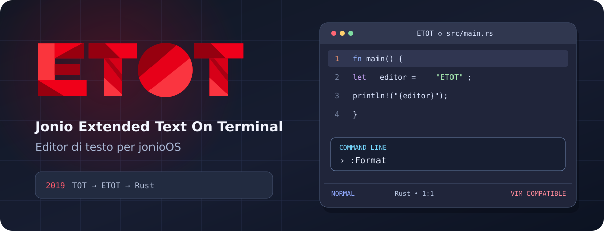

<div align="center">



<h1>Jonio Extended Text On Terminal</h1>

<p><strong>Editor di testo per jonioOS</strong> · <strong>Rust</strong> · <strong>VIM COMPATIBLE</strong></p>

<p><a href="#avvio-rapido">Avvio rapido</a> · <a href="#guida-ai-comandi">Comandi</a> · <a href="#linguaggi-e-strumenti">Linguaggi</a> · <a href="#compatibilità-e-limiti">Stato</a></p>

</div>

## Dal TOT del 2019 a ETOT

Nel **2019**, TOT (*Text On Terminal*) nasce come progetto di editor per **JonioOS Sila**, un sistema operativo in VB.NET. ETOT, *Extended Text On Terminal*, porta avanti quell'idea come programma concreto: un editor da terminale autonomo, scritto in Rust, con strumenti per lavorare sui progetti e un'interfaccia curata.

L'obiettivo è un editor rapido, personalizzabile e **VIM COMPATIBLE**, con navigazione modale e funzioni IDE nello stesso terminale. La compatibilità è in sviluppo: questa pagina descrive ciò che funziona **oggi** e distingue le funzioni ancora mancanti.

## Avvio rapido

ETOT si compila con Cargo e richiede **Rust 1.90 o successivo** per le dipendenze attuali. L'interfaccia è pensata per un terminale Linux con supporto ANSI. Formatter, linter, server LSP e Git richiedono i rispettivi programmi esterni soltanto quando si usano quelle funzioni.

```sh
git clone https://github.com/jonioos/extendedtextonterminal-rs.git
cd extendedtextonterminal-rs
~/.cargo/bin/cargo build --release
./scripts/install-etot
~/usr/bin/etot --edit app.rs
```

Lo script installa il solo eseguibile in `~/usr/bin/etot`. Per scegliere un altro percorso assoluto: `ETOT_INSTALL_PATH=/percorso/etot ./scripts/install-etot`. In alternativa, esegui `./target/release/etot`. Se `~/usr/bin` è nel `PATH`, basta digitare `etot`.

| Avvio | Effetto |
| --- | --- |
| `etot` | Apre un buffer vuoto. |
| `etot file.txt` | Apre un file in Normal. |
| `etot --edit file.txt` | Apre il file direttamente in Insert. |
| `etot --read file.txt` | Apre il file in sola lettura. |
| `etot directory/` | Apre l'esploratore dei file. |
| `etot --help` / `etot --version` | Mostra guida rapida o versione. |

`--edit` e `--read` non si possono combinare. L'installazione Rust non richiede un altro editor come runtime.

## Cosa offre oggi

- **Editing modale:** Normal, Insert, Visual, Visual Line, Visual Block, Replace e Cmdline. Il cursore passa da blocco a barra in Insert nei terminali che supportano il cambio di forma.
- **Editing VIM COMPATIBLE:** conteggi, movimenti, operatori `d/c/y`, text object, indentazione, registri, macro, marks, ripetizione con `.`, undo/redo, ricerca e sostituzione Ex.
- **Lavoro su più file:** buffer, split orizzontali e verticali, tab, esploratore, file picker e ricerca nel progetto.
- **Interfaccia:** tema scuro o chiaro, colori sintattici Tree-sitter, statusline, menu contestuali, suggerimenti nella Cmdline e quickfix. Le etichette sono leggibili anche con MesloLGS.
- **Strumenti di sviluppo:** client LSP, formatter e linter esterni configurabili, Git status/diff/staging e shell interattiva in un pannello inferiore.
- **Continuità del lavoro:** sessioni salvate su richiesta, recupero automatico delle modifiche non salvate dei file nominati e undo persistente; salvataggio atomico con controllo delle modifiche esterne.

## Guida ai comandi

In **Normal**, i tasti agiscono sul testo. `:` apre la **Cmdline**; `Tab` completa i comandi, `Invio` esegue ed `Esc` chiude. I suggerimenti appaiono sotto il campo del comando. In **Insert**, `Esc` torna a Normal.

### Muoversi e cercare

| Comandi | Azione |
| --- | --- |
| `h j k l` oppure frecce | Sinistra, giù, su, destra. |
| `w W b B e E` | Navigazione per parole e WORD. |
| `0 ^ $` | Inizio riga, primo carattere non vuoto, fine riga. |
| `gg G`, `42G` | Inizio/fine file, riga indicata. |
| `{ }`, `%`, `H M L` | Paragrafi, parentesi corrispondente, posizione nella finestra. |
| `f F t T` + carattere, `;` / `,` | Trova un carattere nella riga e ripete la ricerca. |
| `/testo` / `?testo` + `Invio` | Cerca avanti o indietro con anteprima incrementale. |
| `n` / `N`, `*` / `#` | Corrispondenza successiva/precedente; parola sotto il cursore. |
| `↑` / `↓` dopo una ricerca | Scorre le corrispondenze evidenziate; `Esc` chiude l'evidenziazione. |

I conteggi si combinano con molti comandi: `5j` scende di cinque righe, `3w` avanza di tre parole e `2dw` elimina due parole. La ricerca usa regex Rust; la sintassi regex Vim completa non è ancora disponibile.

### Scrivere, selezionare e ripetere

| Comandi | Azione |
| --- | --- |
| `i I a A o O` | Inserisce, aggiunge o apre una riga. |
| `v V Ctrl+V` | Selezione Visual, per righe o a blocchi. |
| `d c y` + movimento/oggetto | Elimina, cambia o copia; esempi: `dw`, `ciw`, `y$`. |
| `dd cc yy`, `x X`, `p P` | Operazioni su righe, caratteri e incolla. |
| `>> <<`, `J`, `~`, `r`, `R` | Indenta, unisce righe, cambia maiuscole, sostituisce. |
| `u` / `Ctrl+R`, `.` | Undo, redo e ripetizione della modifica. |
| `"ayy`, `"ap`, `"+yy`, `"+p` | Registri nominati e clipboard di sistema (`+` o `*`). |
| `qa` … `q`, `@a`, `@@` | Registra una macro nel registro `a`, la riproduce o ripete l'ultima. |
| `ma`, `'a` / `` `a `` | Imposta e raggiunge un mark locale. |
| `Canc` | Elimina la selezione Visual; in Normal equivale a `x`. |

I registri includono quelli nominati e una parte dei registri speciali (`0`, `1–9`, `-`, `_`). La clipboard richiede una sessione grafica che la renda disponibile.

### Comandi ETOT e file

I quattro comandi `$` si possono scrivere nella Cmdline come `:$undo` oppure digitare direttamente in Normal come `$undo` e confermare con `Invio`. Un singolo `$` continua a portare il cursore a fine riga.

| Comando | Azione |
| --- | --- |
| `$undo` / `$redo` | Annulla o ripristina una modifica. |
| `$end` | Salva il buffer attivo e chiude quando non restano modifiche non salvate. |
| `$quit` | Esce senza salvare e scarta il recupero delle modifiche non salvate. |
| `:w`, `:wa`, `:wq` | Salva il file, tutti i buffer modificati, oppure salva ed esci. |
| `:q`, `:q!` | Esce, oppure forza l'uscita senza salvare. |
| `:e file`, `:bn`, `:bp`, `:buffers`, `:bd` | Apre e gestisce i buffer. |
| `:split [file]`, `:vsplit [file]`, `Ctrl+W s/v` | Divide la finestra. |
| `Ctrl+W h/j/k/l`, `Ctrl+W c` | Cambia o chiude lo split. |
| `:tabnew [file]`, `:tabnext`, `:tabprevious`, `:tabclose`, `gt` / `gT` | Gestisce le schede. |
| `:s/vecchio/nuovo/`, `:%s/vecchio/nuovo/g` | Sostituisce nella riga o nel file. |
| `:g/pattern/comando`, `:v/pattern/comando` | Esegue un sottoinsieme dei comandi Ex sulle righe corrispondenti. |
| `:sort`, `:delete`, `:yank`, `:put`, `:join`, `:copy`, `:move`, `:read file` | Operazioni Ex sulle righe. |
| `:set number`, `:set relativenumber`, `:set ignorecase`, `:set smartcase` | Modifica alcune opzioni durante la sessione. |

### Progetto e strumenti IDE

| Comando | Azione |
| --- | --- |
| `Ctrl+P` | Apre il file picker. |
| `:grep pattern` | Cerca nel progetto e apre i risultati nella quickfix. |
| `:GitStatus`, `:GitDiff` | Mostra stato o diff Git; nello stato, `s` aggiunge all'indice ed `Invio` apre il file. |
| `:Format`, `:Lint` | Esegue formatter o linter esterno in background; i risultati riconosciuti arrivano nella quickfix. |
| `gd`, `gr`, `K`, `Ctrl+Spazio` | Definizione, riferimenti, hover e completamento via LSP. |
| `:LspDiagnostics`, `:LspSymbols`, `:LspCodeActions`, `:LspFormat`, `:LspRename nome` | Diagnostica, simboli, azioni, formattazione e rinomina LSP. |
| `:SessionSave [file]`, `:SessionLoad [file]` | Salva o ripristina buffer, tab e layout degli split. |
| `:terminal` | Apre una shell PTY nel pannello inferiore; `Ctrl+\` chiude il pannello. |
| `:!comando` | Esegue un comando esterno tornando poi all'editor. |

## Linguaggi e strumenti

L'evidenziazione **Tree-sitter è inclusa** per Rust, TypeScript, JavaScript, Python, Go, C, C++, C#, VB.NET, HTML, CSS, JSON, YAML, TOML, Bash, Lua e Markdown. Le funzioni LSP e gli strumenti esterni diventano disponibili installando i programmi corrispondenti nel `PATH`.

| Linguaggio | Server LSP preconfigurato | Formatter / linter preconfigurati |
| --- | --- | --- |
| Rust | `rust-analyzer` | `rustfmt` / `cargo check` |
| Python | `pyright-langserver` | `ruff format` / `ruff check` |
| Go | `gopls` | `gofmt` / `go vet` |
| C e C++ | `clangd` | `clang-format` / `clang-tidy` |
| JavaScript e TypeScript | `typescript-language-server` | `prettier` / `eslint` |
| HTML e CSS | `vscode-html-language-server`, `vscode-css-language-server` | `prettier` / nessun linter predefinito |
| C# e VB.NET | `csharp-ls`, `vbnet-ls` | Formattazione LSP se supportata dal server; nessun formatter/linter esterno predefinito |

La diagnostica LSP è distinta da `:Lint`. I comandi esterni sono configurabili per estensione; `{file}` inserisce il percorso e `stdin = true` invia anche le modifiche non ancora salvate. Alcuni linter che leggono solo il file su disco lavorano sull'ultima versione salvata.

## Configurazione, sessioni e dati

ETOT legge `~/.config/etot/config.toml`; un esempio è in [config.toml.example](config.toml.example). La configurazione consente tema, numeri di riga, ricerca `ignorecase`/`smartcase`, indentazione automatica, `shiftwidth`, mapping normali a un carattere, server LSP e strumenti esterni.

```toml
[ui]
theme = "dark"
line_numbers = true

[search]
ignorecase = true
smartcase = true

[tools.py.formatter]
command = ["ruff", "format", "-"]
stdin = true
```

I journal dei file nominati conservano modifiche non salvate e cronologia undo. All'apertura ETOT li ripristina se il file su disco non è cambiato; se è cambiato, avvisa e non sovrascrive il contenuto. Le sessioni sono **manuali**: `:SessionSave` scrive lo stato e `:SessionLoad` lo ripristina; prima del caricamento occorre salvare o scartare i buffer modificati. Il percorso predefinito è `~/.local/state/etot`, oppure `$XDG_STATE_HOME/etot`; `ETOT_STATE_HOME` lo sovrascrive.

Per limitare lavoro e memoria, la sintassi viene calcolata in modo differito e l'evidenziazione completa è omessa oltre **256 KiB**; la cronologia undo in memoria ha un limite di **32 MiB**. Questi limiti non equivalgono a supporto ottimizzato per file molto grandi.

## Compatibilità e limiti

ETOT è **VIM COMPATIBLE**, ma **non** implementa ancora il 100% di Vim. Mancano l'interprete Vimscript, `:source`, funzioni e autocmd Vimscript, le regex Vim complete, parte dei registri speciali, alcuni comandi Ex e casi avanzati di operatori, text object e macro. Snippet, debugger e sistema di plugin non sono ancora presenti. La gestione Unicode e il recovery quando un file cambia esternamente hanno ancora limiti.

Lo stato dettagliato è in [docs/compatibility.md](docs/compatibility.md) e [docs/stato.md](docs/stato.md). Il progetto segue un obiettivo preciso: rendere ETOT sempre più capace senza perdere l'identità di editor da terminale leggero e diretto.

---

<div align="center">


<p><strong>© 2019–2026 Jonio Extended Text On Terminal</strong></p>

</div>
